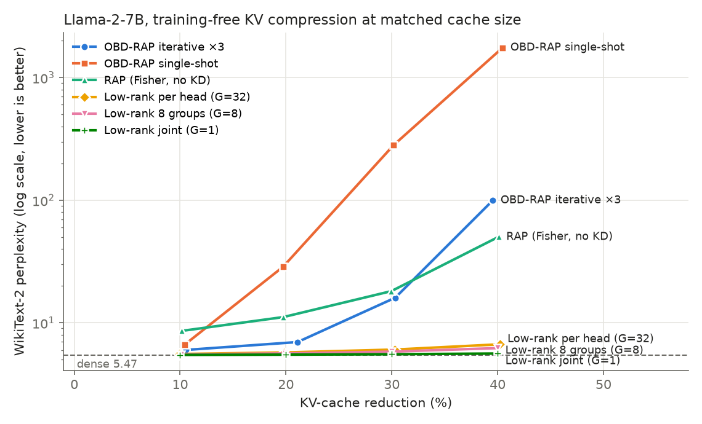
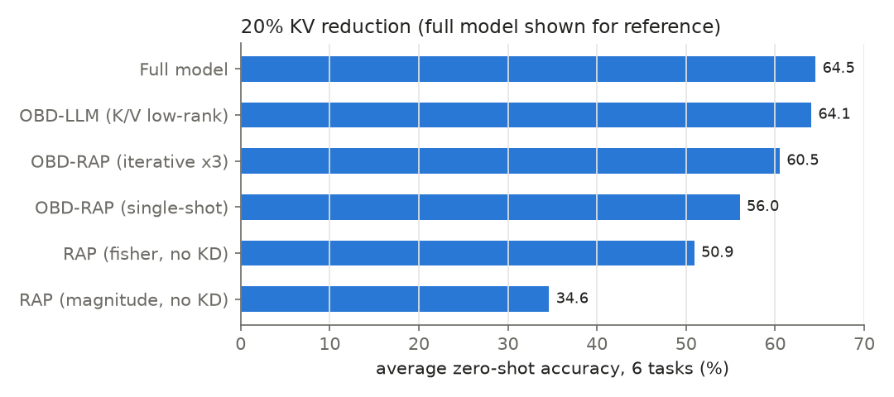
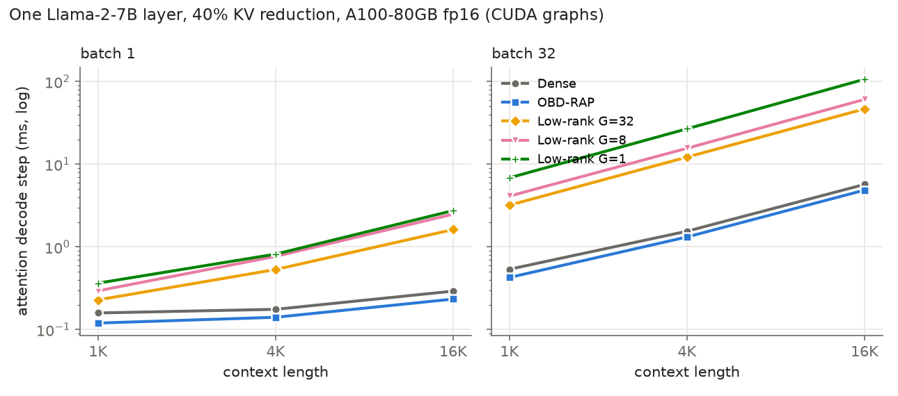

# OBD-RAP: training-free KV-cache compression that keeps RoPE intact

Class project (Pattern Recognition, Chulalongkorn University). OBD-RAP shrinks the KV cache
of a RoPE-based LLM without any training: it removes whole RoPE dimension pairs from the key and
value projections, chooses which pairs to remove with a second-order (OBD) score, and corrects
the remaining weights with an OBS update.

> **Status: research prototype, negative-leaning result.** OBD-RAP reproduces and clearly beats
> RAP without distillation, but whitened low-rank K/V compression gives much better quality at the
> same cache size. Details and open directions are in [Current status](#current-status).

## Method

OBD-RAP combines two earlier ideas:

| From | Idea used here |
|---|---|
| **OBD-LLM** | K-FAC Hessian `H ≈ C_x ⊗ C_g`; weights are scored in the bi-whitened space `W̃ = L_gᵀ W L_x` |
| **RAP** | prune whole RoPE pairs `(j, j + D/2)` so rotary position encoding stays exact on the kept dims |

Per attention layer:

1. Collect `C_x` (inputs of `k_proj`) and `C_g` (output gradients of `k_proj`/`v_proj`) on 128 × 2048 WikiText-2 tokens.
2. Score every RoPE pair by `‖W̃[j]‖² + ‖W̃[j′]‖²`, plus a correction term for the off-block-diagonal part of `C_x`.
3. Keep the top-s pairs per head (with an adaptive per-layer budget for single-shot, or 3 rounds of re-estimation for iterative mode).
4. Compensate the kept rows with the structured OBS update `δW_R = C_g[R,R]⁻¹ C_g[R,S] W_S`.
5. Absorb the pruning into `W_q` and `W_o`, keep the original `1/√D` attention scale, and apply RoPE on the kept, non-contiguous dims.

## Results (Llama-2-7B)

All methods were run in one pipeline with the same calibration data, protected layers (first 2 and last 3) and evaluation.
Perplexity is WikiText-2 test, 2048-token windows.



| KV reduction | OBD-RAP iter ×3 | OBD-RAP single | RAP (Fisher, no KD) | Low-rank G=32 | Low-rank G=8 | Low-rank G=1 |
|---|---|---|---|---|---|---|
| 10% | 6.01 | 6.65 | 8.59 | 5.57 | 5.53 | 5.48 |
| 20% | 6.97 | 28.6 | 11.1 | 5.73 | 5.63 | 5.50 |
| 30% | 16.0 | 282 | 18.1 | 6.05 | 5.82 | 5.54 |
| 40% | 99.8 | 1754 | 50.2 | 6.68 | 6.22 | 5.62 |

Dense model: 5.47. "Low-rank" is OBD-LLM's whitened decomposition applied to `W_k`/`W_v` only, with one latent
per group of `32/G` heads. The cache stores the latent, so keys must be rebuilt before RoPE at every decode step.



Average over PIQA, ARC-e, ARC-c, HellaSwag, WinoGrande and OpenBookQA (acc_norm where available).

### Decode speed



The benchmark times one decode step of one attention layer at Llama-2-7B size, with every method at the same cache size.
Before timing, each variant is checked against plain attention with equivalent dense weights.

- OBD-RAP needs no reconstruction, so it is **3–20× faster than low-rank caches** as written here. The gap grows with batch and context.
- Against dense attention it is only **0.85–1.05×**. The saving is mostly memory, not latency.
- Kept-pair counts must be multiples of 4 (head width a multiple of 8). Otherwise SDPA falls back from FlashAttention and pruned heads become 3–5× *slower* than dense.
- Caveat: the low-rank path is plain PyTorch. A fused kernel (as in Palu) would narrow the gap, especially for per-head latents.

## Current status

**What holds up**
- At 10–30% KV reduction, OBD-RAP has 30–40% lower perplexity than RAP without KD.
- At 20%, its average accuracy is 9.6 points higher than RAP.
- Iterative pruning matters a lot (20%: 6.97 vs 28.6 single-shot).

**What does not**
- At matched cache size, even per-head low-rank, the cheapest one to rebuild, beats OBD-RAP at every ratio (40%: 6.68 vs 99.8).
- The theory agrees: pruning is low-rank restricted to row selection, so at equal width it can never beat the best low-rank fit.
- Above about 30%, OBD-RAP is very sensitive to the per-round schedule.

**Limitations**
- Multi-head attention only (no GQA yet).
- One model (Llama-2-7B).
- Decode latency is measured per layer, not end-to-end.
- lm-eval was run only for some configurations.

**Next.** I am working on RoPE-compatible ways to mix dimensions beyond pair selection. The goal is to close the
quality gap to low-rank while keeping OBD-RAP's zero reconstruction cost at decode time.

## Repository layout

```
obd_rap.py              core math: RoPE pairs, whitening, scores, budget, OBS update, Q/O absorption, subset RoPE
obd_rap_pipeline.py     experiment pipeline for HF LLaMA: statistics, OBD-RAP, RAP and OBD-LLM K/V baselines, evaluation
decode_bench.py         decode-step latency benchmark (dense / pruned / grouped low-rank)
tests/                  offline correctness tests on a tiny random LLaMA (no downloads)
scripts/make_figures.py rebuilds figures/ from results/
results/                result tables used in this README
```

## Running

```bash
pip install -r requirements.txt
python tests/test_obd_rap_pipeline.py      # pipeline checks, CPU, ~1 min
python tests/test_decode_bench.py          # benchmark equivalence checks
python scripts/make_figures.py
```

Full experiments were run on a Colab A100 (Llama-2-7B needs a Hugging Face token). The Colab notebook will be
added once it is cleaned up; meanwhile the pipeline API drives every configuration:

```python
import obd_rap_pipeline as P
P.run_compression(model, P.RunConfig(ratio=0.4, n_rounds=3), dense_cov, calib)           # OBD-RAP iterative
P.run_compression(model, P.RunConfig(ratio=0.4, method="obd_llm_kv", lr_groups=8), dense_cov, calib)
P.run_compression(model, P.RunConfig(ratio=0.4, method="rap", score_type="fisher", use_obs=False),
                  dense_cov, calib, fisher=dense_fisher)

import decode_bench as db
rows = db.run_grid()   # GPU latency grid
```

## References

- OBD-LLM: optimal brain decomposition for LLM compression (bi-directional K-FAC whitening).
- RAP: RoPE-aligned pruning for KV-cache compression.
- LLM Surgeon (van der Ouderaa et al.): the multi-row OBS update used here matches their Eq. 27.
- Palu: low-rank KV-cache compression with grouped latents.
